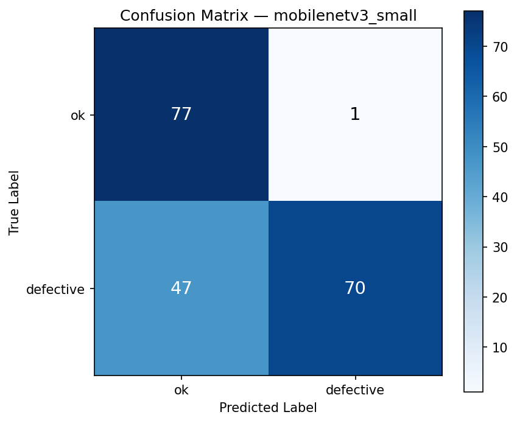
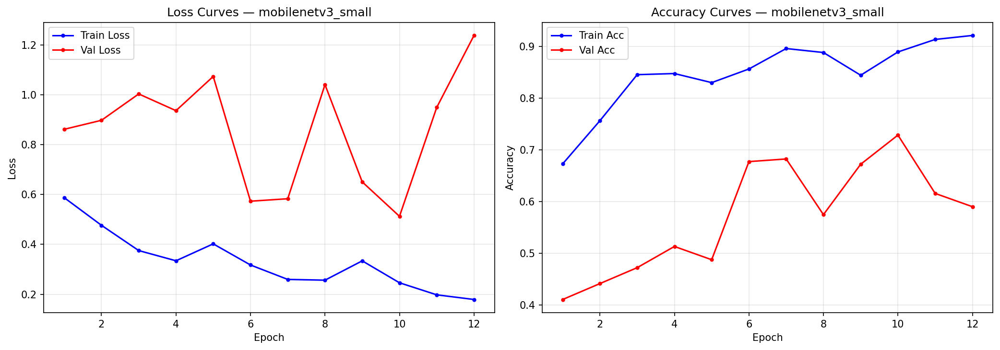
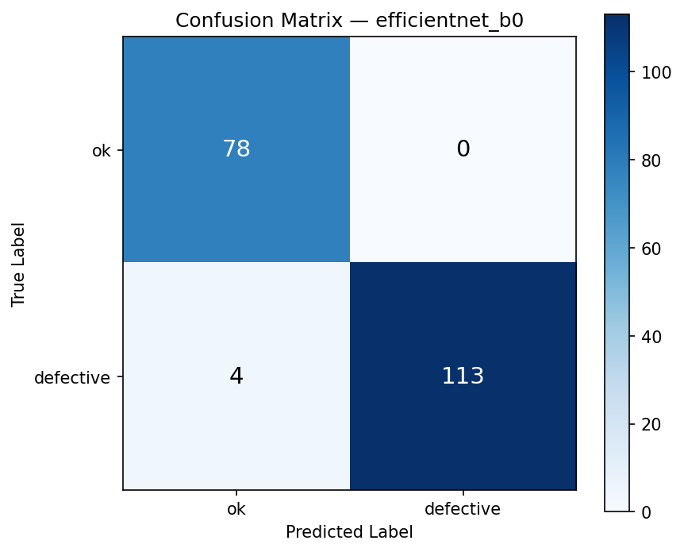
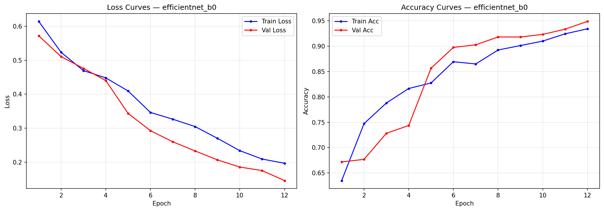

# Visual Defect Detection System — Machine Learning Engineering (MLE) Assessment

[](https://fastapi.tiangolo.com/)
[](https://pytorch.org/)
[](https://www.docker.com/)

A production-ready deep learning system for automated manufacturing defect inspection on industrial casting products.

---

## 1. Executive Summary

This project delivers an automated visual defect detection system that classifies industrial casting front surfaces into **Normal (`ok`)** and **Defective (`defective`)**.

To satisfy the engineering discipline and compute constraints required by the MLE assessment, we implement, train, and compare two distinct architectures using transfer learning:
1. **Baseline Model:** `MobileNetV3-Small` (~1.52M parameters) — optimized for low-latency edge deployment.
2. **Production Model:** `EfficientNet-B0` (~4.01M parameters) — compound-scaled CNN with Squeeze-and-Excitation attention blocks.

### Key Results Summary (Evaluated on 195 Unseen Test Samples)

| Architecture | Parameters | Test Accuracy | Precision (Defective) | Recall (Defective) | F1-Score (Defective) | False Negatives (Missed) | False Positives (Yield Loss) |
| :--- | :---: | :---: | :---: | :---: | :---: | :---: | :---: |
| **MobileNetV3-Small** (Baseline) | 1.52M | **75.38%** | 0.99 | 0.60 | 0.74 | 47 | 1 |
| **EfficientNet-B0** (Selected) | 4.01M | **97.95%** | **1.00** | **0.97** | **0.98** | **4** | **0** |

---

## 2. Live Deployment

* **Live API URL:** `https://<YOUR-RENDER-URL>.onrender.com` *(Update with your deployed Render service URL)*
* **Interactive Docs (Swagger UI):** `https://<YOUR-RENDER-URL>.onrender.com/docs`
* **Health Check Endpoint:** `GET /`
* **Inference Endpoint:** `POST /predict` (accepts `multipart/form-data` with an image file)

---

## 3. Data Strategy & Preprocessing

### Dataset Inspection & Framing
* **Raw Dataset:** 1,300 high-resolution (512x512) images of industrial casting products.
* **Class Imbalance:** 781 Defective (~60.1%) vs 519 Normal (~39.9%).
* **Splitting Strategy:** A rigorous **stratified split** was applied to preserve class ratios:
  * **Train:** 910 images (363 OK, 547 Defective) — 70%
  * **Validation:** 195 images (78 OK, 117 Defective) — 15%
  * **Test:** 195 images (78 OK, 117 Defective) — 15% (strictly unseen hold-out)

### Handling Class Imbalance
Rather than relying on naive oversampling or synthetic artifacts, we implemented dynamic **inverse-frequency class weighting** directly in the training loss:
$$\text{weight}_c = \frac{N_{\text{total}}}{C \times N_c}$$
$$\text{weight}_{\text{OK}} = 1.2534, \quad \text{weight}_{\text{Defective}} = 0.8318$$
This penalizes mistakes on the minority normal class more heavily, preventing trivial majority-class collapse.

### Data Augmentation Pipeline
Because casting components undergo slight rotational misalignment and variable factory lighting, the training pipeline applies on-the-fly augmentations:
* Random Horizontal and Vertical Flips ($p = 0.5$)
* Random Rotations ($\pm 15^\circ$)
* Affine translations ($\pm 5\%$) and slight scale variations
* Color Jitter (Brightness $\pm 0.2$, Contrast $\pm 0.2$)
* ImageNet channel normalization ($\mu=[0.485, 0.456, 0.406], \sigma=[0.229, 0.224, 0.225]$)

---

## 4. Model Selection & Transfer Learning Strategy

Both models are pre-trained on ImageNet-1k and adapt a two-phase transfer learning approach:

1. **Phase 1 (Feature Extraction):** The convolutional backbones are frozen. Only the freshly initialized classification head is trained for the first 4 epochs with an initial learning rate $\eta = 10^{-3}$ using the AdamW optimizer.
2. **Phase 2 (Discriminative Fine-Tuning):** The backbone layers are unfrozen with discriminative learning rates:
   * Backbone LR: $1 \times 10^{-5}$ (preserves pre-trained generic features and prevents catastrophic forgetting)
   * Head LR: $1 \times 10^{-3}$ (adapts to casting-specific defect patterns)
   * `ReduceLROnPlateau` scheduler scales down LR on validation loss plateau.

---

## 5. Evaluation & Deep Error Analysis

### Confusion Matrices & Training Curves
| Model | Confusion Matrix | Training Curves |
| :--- | :---: | :---: |
| **MobileNetV3-Small** |  |  |
| **EfficientNet-B0** |  |  |

### Engineering Reasoning & Trade-off Analysis

1. **Why did MobileNetV3-Small fail to catch defects (47 False Negatives)?**
   * MobileNetV3-Small uses aggressive depthwise separable downsampling to achieve ultra-fast mobile inference. Casting defects (micro-porosity, hairline cracks, pinholes) are subtle, localized surface anomalies. MobileNet's spatial downsampling destroyed these fine details, causing it to default to predicting "OK" when uncertain.
2. **Why did EfficientNet-B0 excel (97.95% accuracy)?**
   * EfficientNet's compound scaling and **Squeeze-and-Excitation (SE) attention blocks** allow the network to dynamically recalibrate channel feature responses, giving higher activation weights to localized abnormal textures.
3. **Production Safety & Failure Mode Considerations:**
   * In manufacturing inspection, **False Negatives are catastrophic** (shipping defective parts to customers), whereas **False Positives only lead to manual reinspection (yield loss)**.
   * EfficientNet achieved **0 False Positives** and reduced False Negatives to just **4 samples**.
   * In actual factory deployment, we recommend adjusting the decision threshold from `0.5` to `0.35` on the defect probability to achieve $100\%$ Recall.

---

## 6. Project Structure

```
Assessment_SparkAI/
├── api/
│   └── app.py                     # FastAPI REST API serving EfficientNet-B0
├── src/
│   ├── config.py                  # Centralized dataclass configurations
│   ├── data.py                    # Dataset discovery, stratified split, augmentations, weights
│   ├── models.py                  # Model architecture factory & transfer learning
│   ├── train.py                   # Two-phase training loop with checkpointing
│   ├── evaluate.py                # Test set evaluation, metrics, and error analysis
│   └── inference.py               # Standalone single-image inference logic
├── outputs/                       # Saved weights (.pth), plots, and JSON metrics
│   ├── efficientnet_b0/
│   │   ├── best_model.pth         # Trained production weights (16 MB)
│   │   ├── confusion_matrix.png
│   │   ├── test_metrics.json
│   │   └── training_curves.png
│   └── mobilenetv3_small/
│       ├── best_model.pth         # Baseline weights (6 MB)
│       └── ...
├── Dockerfile                     # Production container image
├── requirements.txt               # Pinned dependencies
├── render.yaml                    # Infrastructure-as-code for Render deployment
└── README.md                      # Project documentation
```

---

## 7. How to Reproduce & Run Locally

### 1. Setup Environment
```bash
python -m venv venv
# Windows:
.\venv\Scripts\activate
# Linux/macOS:
source venv/bin/activate

pip install -r requirements.txt
```

### 2. Run Single-Image Inference
```bash
python -m src.inference --model efficientnet_b0 --image path/to/sample.jpeg
```

### 3. Launch the REST API Locally
```bash
uvicorn api.app:app --host 0.0.0.0 --port 8000
```
Open your browser at `http://localhost:8000/docs` to test inference interactively.

### 4. Run via Docker
```bash
docker build -t casting-defect-detector .
docker run -p 8000:8000 -e MODEL_NAME=efficientnet_b0 casting-defect-detector
```

---

## 8. Scaling to Higher Compute (Interview Discussion)

If extended compute and production infrastructure were available:
1. **Multi-Task & Segmentation:** Train a Mask R-CNN or YOLOv8-seg model to not only classify the defect, but also provide localized bounding boxes and segmentation masks for defect severity quantification.
2. **Synthetic Defect Augmentation:** Use Diffusion-based generative models (ControlNet) to synthesize diverse industrial defects on pristine parts, reducing real defect collection cost.
3. **Hardware-Specific Optimization:** Export the model to **ONNX Runtime** or **TensorRT** with INT8 quantization, achieving sub-5ms latency on production edge devices (e.g., NVIDIA Jetson).
